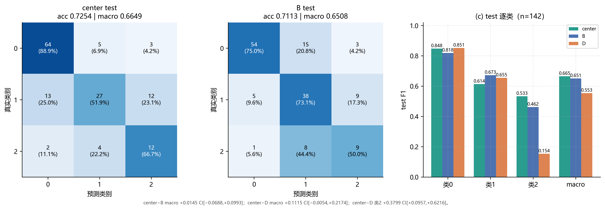
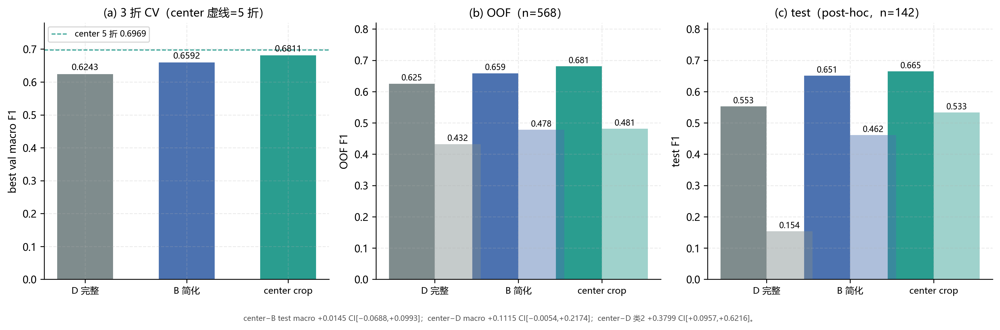
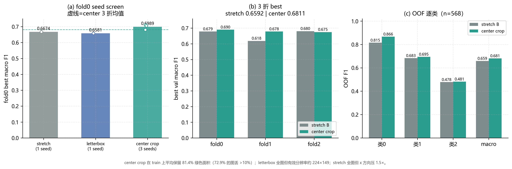
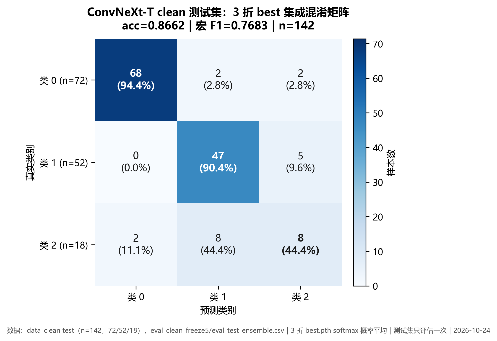

# CSM-Net

**角膜荧光素染色图像的 3 类分类网络**<br>
从零训练 · 2.036M 参数 · 4 通道输入 · 单卡 RTX 4060 可复现

<p>
  
  
  
</p>

<p align="center">
  
</p>
<p align="center">
  <sub>clean test（n=142）：左为 CSM-Net center，中为消融 B，右为逐类 F1。</sub>
</p>

## 一眼看懂

CSM-Net 是一个**不加载任何预训练权重**的轻量卷积网络。它先擦掉图像里自带的红色轮廓叠加，再把荧光素响应显式构造成第 4 个通道：

```text
S = ReLU(G - 0.5(R + B)) × 4
```

RGB + S 进入 4 个 stage 的双感受野残差块（DRSB），最后用多尺度池化做 3 类分类。

在 clean test（n=142）上：

- **acc 0.7254**，**宏 F1 0.6649**，类 2 F1 **0.5333**
- 3 折 best-val 宏 F1 **0.6811 ± 0.0080**，OOF 宏 F1 **0.6808**
- 5 折 center 宏 F1 **0.6969 ± 0.0324**
- 2.036M 参数，90 epoch，单卡 RTX 4060 可训练

> 这不是一个声称 SOTA 的模型。ConvNeXt-T 的整体指标更高；CSM-Net 的差异点是从零训练、2M 参数，以及更高的类 2 F1。CSM-Net 与 ConvNeXt 的对比在同一份 clean test 上完成；MedMamba 使用 raw test，单独标注。center 与 B 的差异置信区间跨 0，不宣称稳定胜出。

## 结果

| 模型 | 初始化 | 参数量 | test | acc | 宏 F1 | 类 2 F1 |
|---|---|---:|---|---:|---:|---:|
| **CSM-Net center** | 从零 | 2.036M | clean，n=142 | **0.7254** | **0.6649** | **0.5333** |
| CSM-Net B | 从零 | 2.036M | clean，n=142 | 0.7113 | 0.6508 | 0.4615 |
| CSM-Net D-120 | 从零 | 2.365M | clean，n=142 | 0.7113 | 0.5532 | 0.1538 |
| ConvNeXt-T | ImageNet-1k | 27.82M | clean，n=142 | 0.8662 | 0.7683 | 0.4850 |
| MedMamba VSSM-tiny | DermaMNIST | 14.45M | raw，n=143 | 0.6993 | 0.6277 | 0.4440 |

MedMamba 使用未去重的 raw test，ConvNeXt 与 CSM-Net 使用去重后的 clean test；两个测试集不同，不能直接按数字排名。

3 折与 OOF 的对照：

| 配方 | 3 折 best-val 宏 F1 | OOF 宏 F1 | clean test 宏 F1 |
|---|---:|---:|---:|
| **center** | **0.6811 ± 0.0080** | **0.6808** | **0.6649** |
| B（stretch） | 0.6592 ± 0.0353 | 0.6587 | 0.6508 |
| D-120 | 0.6176 ± 0.0022 | 0.6202 | 0.5532 |

<p align="center">
  
</p>
<p align="center">
  <sub>左：3 折 CV；中：OOF（n=568）；右：clean test（n=142）。center 在 CV 上稳定领先，但 test 与 B 的宏 F1 差 +0.0145，95% CI [−0.0688, +0.0993]，跨 0。</sub>
</p>

## 方法

```text
原图 → 去红线 → [R, G, B, S] → Stem → S1 → S2 → S3 → S4 → 多尺度池化 → 3 类
                                      ↑        ↑        ↑        ↑
                                   4 × DRSB（dw3×3 / dw5×5 + SE + drop-path）
```

- **去红线**：红色轮廓是图像自带的叠加标记，来源未标注；直接训练会让模型有机会学标记而不是染色形态。全分辨率检测后缩到短边 512，`dilate=3` 覆盖抗锯齿边缘，再用最近邻填充；不引入 cv2 或新依赖。
- **S 通道**：`S = ReLU(G - 0.5(R+B)) × 4`，把荧光素的高响应区域显式喂给模型，而不是让网络自己从 RGB 里猜。
- **DRSB**：每个 block 并行 depthwise 3×3 与 5×5，分别覆盖点状与片状染色；1×1 融合、SE 通道重标定、残差 + drop-path。
- **center crop**：验证/测试用 `Resize(短边 256) + CenterCrop(224)`；在 train 图像上统计，平均保留约 81.4% 的绿色高响应面积。
- **无预训练**：不加载 ImageNet、DermaMNIST 或任何外部权重，从零训练。

<p align="center">
  
</p>
<p align="center">
  <sub>几何口径对比：stretch 全图但 x 方向压缩 1.5×；letterbox 全图不变形但有效分辨率低；center crop 保比例、裁边，在 CV 上最好。letterbox 的 0.6581 是旧 scale 1.0 口径，代码统一到 1.1 后未重跑。</sub>
</p>

### 消融

| 版本 | 输入 | 去红线 | S 门 | 辅助头 | 参数量 | OOF 宏 F1 |
|---|---|---|---:|---:|---:|---:|
| B | RGB+S | 是 | 否 | 否 | 2.036M | 0.6587 |
| **center** | RGB+S | 是 | 否 | 否 | 2.036M | **0.6808** |
| D-120 | RGB+S | 是 | 是 | 是 | 2.365M | 0.6202 |

- 去红线 + S 输入（A→B）在 fold0 上把宏 F1 从 0.6595 提到 0.6674，类 2 F1 从 0.304 提到 0.429。
- 加 Stain Gate / 边界池化（B→C）没有稳定净收益，最终关闭。
- 加辅助头（C→D）把决策推向类 2，但牺牲类 1 和整体宏 F1，最终关闭。
- center crop 相对 stretch B 的 3 折均值 +0.0219，方差从 0.0353 降到 0.0080。

A/C 是 fold0 单 seed 筛选，B/D 有 3 折；上表只列最终候选。上表的 D-120 是原始 120 epoch 完整配方；A/B/C/D 的 90 epoch 消融见 [CSMNet/README.md](CSMNet/README.md)。

## 与强基线的关系

<p align="center">
  
</p>
<p align="center">
  <sub>ConvNeXt-T（ImageNet-1k，freeze5）clean test：acc 0.8662、宏 F1 0.7683；类 2 F1 0.485。</sub>
</p>

ConvNeXt-T 仍是整体最强的基线。它的类 2 F1 也只有 0.485，说明类 2 的困难不是 CSM-Net 独有的。CSM-Net 的定位是：

- 从零训练，2.036M 参数，不依赖外部预训练权重；
- 类 2 F1 0.5333，高于 ConvNeXt-T 的 0.4850；
- 整体 acc / 宏 F1 低于 ConvNeXt-T，不做“全面超过”的表述。

MedMamba 作为另一条对照，只保留结果与方法说明，不随仓库分发上游代码，原因见 [NOTICE](NOTICE)。

## 快速开始

### 环境

| 项 | 值 |
|---|---|
| Python | 3.10.22 |
| PyTorch | 2.6.0+cu124 |
| torchvision | 0.21.0+cu124 |
| numpy / scipy / scikit-learn | 1.26.4 / 1.15.3 / 1.7.2 |
| Pillow | 12.3.0 |
| GPU | NVIDIA RTX 4060 Laptop 8GB（sm_89） |

```powershell
python -m pip install torch==2.6.0 torchvision==0.21.0 `
  --index-url https://download.pytorch.org/whl/cu124
python -m pip install -r requirements.txt
```

### 数据

数据受隐私与使用限制，不随仓库分发。复现时把同结构的图像放到：

```text
data_clean/
├─ train/0/*.jpg
├─ train/1/*.jpg
├─ train/2/*.jpg
├─ test/0/*.jpg
├─ test/1/*.jpg
└─ test/2/*.jpg
```

### 训练与评估

```powershell
# 最终 center 配方：3 折，90 epoch，强增强，head128，无 Stain Gate / 辅助头
python CSMNet/train.py cv --folds 3 --epochs 90 --warmup 3 --bs 32 --workers 4 `
  --strong-aug --head-dim 128 --head-dropout 0.4 --wd 0.1 --ls 0.1 `
  --ratio-mode center_crop --no-stain-gate --no-aux `
  --data-root ../data_clean `
  --out-dir run/csmnet/center_cv_90_strong

# clean test 一次性评估：3 折 best 的 softmax 概率平均
python CSMNet/train.py eval --checkpoints `
  run/csmnet/center_cv_90_strong/fold0/best.pth `
  run/csmnet/center_cv_90_strong/fold1/best.pth `
  run/csmnet/center_cv_90_strong/fold2/best.pth `
  --ratio-mode center_crop --no-stain-gate --no-aux `
  --head-dim 128 --head-dropout 0.4 `
  --data-root ../data_clean `
  --out-dir run/csmnet/eval_center_final
```

完整参数、消融与失败尝试见 [CSMNet/README.md](CSMNet/README.md)；ConvNeXt 的复现见 [ConvNeXt/README.md](ConvNeXt/README.md)。

## 仓库结构

```text
.
├─ CSMNet/              # 数据管线、模型、训练/评估入口
│  ├─ data.py           # 去红线、S 通道、几何预处理
│  ├─ model.py          # DRSB、Stain Gate、辅助头
│  └─ train.py          # smoke / fold / cv / eval
├─ ConvNeXt/            # ImageNet-1k 强基线（MIT）
├─ MedMamba/            # 结果与方法；上游代码不随仓库分发
├─ assets/              # README 图表
├─ requirements.txt
├─ NOTICE               # 第三方组件与许可
└─ LICENSE              # 原创部分 MIT
```

## 局限

- clean test 只有 142 张，类 2 只有 18 张；单次宏 F1 的置信区间较宽，0.01 量级的差异不能当作稳定收益。
- 没有病人 ID，3 折/5 折都是随机分层划分。dHash 近邻审计显示每折约 23–28% 的验证图在训练集中存在近邻；这只能提示风险，不能完成 patient-level split。
- CSM-Net 的 test 累计读取 9 次（D 主集成 1 + D 单折 3 + B 主集成 1 + B 单折 3 + center 主集成 1），后续数字都属于重复使用。
- center 与 B 的 test 宏 F1 差 +0.0145，95% CI [−0.0688, +0.0993]，跨 0；不宣称 center 稳定超过 B。
- MedMamba 使用 raw test，ConvNeXt 与 CSM-Net 使用 clean test，跨模型数字只作背景，不做严格排名。
- 所有数字与图表来自实际训练/评估 CSV，没有模拟数据。

> 红线擦除的 uint8 回绕已修正；用现有 center 三折 checkpoint 在新旧擦除下对比，clean test 142 张预测完全一致，最大概率差 0.0075。结果表保留。

## 许可与致谢

- 本仓库原创部分：MIT License，版权归 Yui-0818，见 [LICENSE](LICENSE)。
- ConvNeXt：MIT License，版权归 Meta Platforms, Inc. and affiliates，见 [ConvNeXt/LICENSE](ConvNeXt/LICENSE) 与 [NOTICE](NOTICE)。
- MedMamba：上游未附 LICENSE。本仓库不包含其模型代码、权重或派生代码，仅保留结果、方法说明与引用；不对该部分重新授权，也不声称拥有其版权。
- 医学图像数据由数据提供方提供，受隐私与使用限制，版权归原数据提供方；本仓库不分发任何图像、标签或预训练权重。
